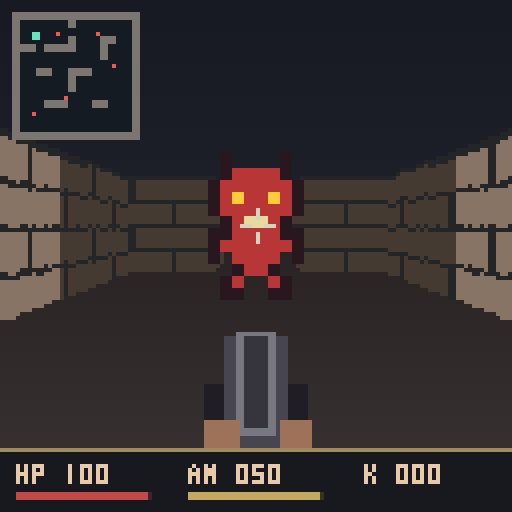

# MIPS DOOM

A small, playable Doom-style first-person shooter written in MIPS assembly for
MARS 4.5. This is an original raycasting game, not a port of the original Doom
engine. No WAD files, downloaded art, or external game libraries are needed.



## Play on this Mac

1. Double-click `launch.command` (or run `./launch.command` in Terminal).
   It uses the existing `/Applications/Mars.jar` installation.
2. In MARS, **File → Open** → select `doom.asm` in this folder.
3. Use the **Default** memory configuration. Enable extended/pseudo instructions
   and leave **Delayed branching** disabled. Assemble with **Run → Assemble** (F3).
4. Open **Tools → Bitmap Display**, using these exact settings:

   | Setting | Value |
   | --- | --- |
   | Unit Width in Pixels | 4 |
   | Unit Height in Pixels | 4 |
   | Display Width in Pixels | 512 |
   | Display Height in Pixels | 512 |
   | Base address for display | `0x10010000` (static data) |

5. Click **Connect to MIPS** in Bitmap Display.
6. Open **Tools → Keyboard and Display MMIO Simulator** and click
   **Connect to MIPS** there too.
7. Set the execution speed slider to **unlimited** and choose **Run → Go** (F5).
8. Click inside the keyboard tool's lower **Keyboard** input area and play.
   Keys typed into the editor, Run I/O console, or bitmap window do not control
   the game. Use lowercase letters (Caps Lock off).

If the display stays blank, connect both tools, reset/reassemble, then run again.
Connect before running so the bitmap tool observes the framebuffer writes.
MARS keyboard input is character-based, so holding a key uses the operating
system's key repeat; simultaneous key combinations are not supported.

## Controls and objective

| Key | Action |
| --- | --- |
| W / S | Walk forward / backward |
| A / D | Turn left / right |
| Z / C | Strafe left / right |
| Space | Shoot |
| M | Toggle minimap |
| R | Restart, including after victory or death |
| Q | Quit the running program |

Clear all **five demons**. Each takes two hits. You start with 100 health and
50 shots; there are no ammunition pickups. Walls stop movement and gunfire.
Nearby demons move toward you and deal damage when they reach you. The HUD shows
`HP` (health), `AM` (remaining shots), and `K` (kills). On the minimap, you are
mint green and enemies are red. Demons use simple local pursuit and can get
stuck behind corners; explore the map to find them.

## Verification

```sh
python3 verify.py
```

This runs the assembly's deterministic self-test in MARS, checks the resulting
framebuffer, and generates `preview.png` directly from simulated MIPS memory.
It tests movement, collision, wall-blocked shots, damage, death, restart, empty
ammo, victory, input after game over, every viewing direction, and close-up
rendering. It does not automate the GUI's keyboard or display-tool connections.

To run only the assembly self-test:

```sh
java -jar /Applications/Mars.jar nc ae1 se1 doom.asm pa --test
```

Any program argument enables test mode; normal GUI play should have no program
arguments. If you installed MARS elsewhere, set `MARS_JAR` for the launcher and
verification script. The [official MARS download page](https://dpetersanderson.github.io/download.html)
provides the simulator. Java is required; the game was tested here with MARS 4.5
and Java 25.

## Implementation

All gameplay and rendering live in `doom.asm`. The launcher and Python verifier
are convenience tools, not part of the game engine.

- 128×128 framebuffer: 112 rows of 3D view plus a 16-row HUD.
- Integer-only Q8 coordinates, a 32-direction rotation table, and a camera plane
  for perspective-correct ray depths.
- Rays march in 1/16-tile increments with Q12 position accumulators.
- Procedural brick walls, distance shading, gradient ceiling/floor, an overlaid
  shotgun, muzzle flash, and transparent demon sprites.
- Per-pixel depth buffer for wall/sprite and sprite/sprite occlusion.
- Collision padding and separate X/Y movement allow sliding along walls.
- Memory-mapped keyboard input; MARS time/sleep syscalls drive enemy updates.

Framebuffer: `0x10010000–0x1001ffff`. Depth buffer:
`0x10020000–0x1002ffff`. Game data follows at `0x10030000`.
The 16×16 ASCII map uses `0` for floor, `1` for stone, and `2` for teal walls.
Keep its solid outer border and put player/enemy spawns on floor tiles.
